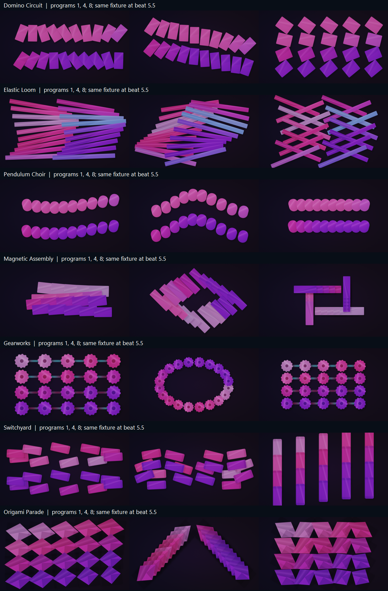
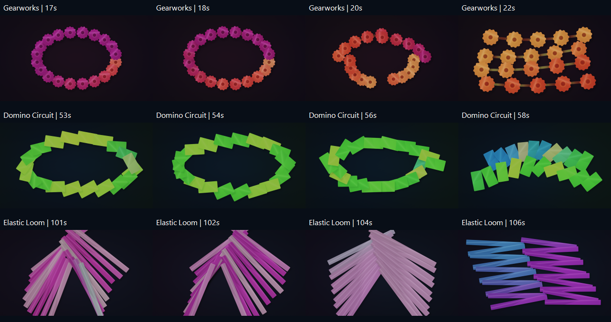

# Visual direction reset after v0.24

September 12, 2026. The user rejected **all seven** scenes shown: Domino Circuit, Elastic Loom, Pendulum Choir, Magnetic Assembly, Gearworks, Switchyard and Origami Parade. This is an audit and implementation brief, not a claim that their replacements have shipped. Catalog expansion is subordinate to correcting these scenes.

Implementation follow-up: [v0.25 Graphic Worlds](GRAPHIC_WORLDS.md) develops the approved 2D direction and excludes these seven scenes from automatic selection. This audit records the v0.24 evidence that motivated that change.

## Finding

The additions have different outlines but too much of the same visual construction: twenty similarly weighted pieces, a largely empty backdrop, broad periodic movement and similar surface shading. Some formations overlap into piles. Their names promise actions—falling, weaving, swinging, assembling, gearing, routing, folding—that the renderer only weakly communicates.

Smoothness alone is insufficient. An action needs a visible intention, an arrival and a consequence. A row can accelerate, turn, lock into place and briefly hold while the surrounding composition continues moving. Removing beat nudges should not remove rhythmic articulation.

## Evidence inspected

- Current source at `077d29d883a976b8e5b55501f0951c6e5b3702e9`.
- Twenty-one production-renderer stills: all seven scenes, programs 1, 4 and 8, at beat 5.5. They use the same palette and fixture to expose composition differences. This is a representative sample, not a review of all seventy programs over complete songs.
- Twelve sequential samples from the existing v0.24 preview: Gearworks at 17/18/20/22 seconds, Domino Circuit at 53/54/56/58 seconds and Elastic Loom at 101/102/104/106 seconds. Each row includes a programmed formation change. The original preview uses synthetic accents and contains no audio.
- Browser visual sampling of the references listed below, plus firsthand production notes. Visual sampling is not an audio/listening test or a full-show timing analysis. No reference media was downloaded or incorporated into RareStage.



The temporal samples below show another similarity: both gears and domino pieces travel from a ring into banks. Elastic Loom changes arrangement, but its crossings still lack the ordering that would make them read as a weave. These are sampled sequences, not exhaustive coverage of each scene's motion.



### Reference observations and interpretation

**Geoxor — Aether.** The sampled official video uses a prominent central character surrounded by concentric graphic detail and a coherent mint/pink palette. My interpretation: supporting repetition strengthens a focal image; equal emphasis on every repeated object is unnecessary. This does not imply RareStage needs anime characters. [Official video](https://www.youtube.com/watch?v=x2IE64sLXh4)

**Geoxor & SVRGE — DEAD.** At the sampled 1:04 position, a large central character and oversized background lettering dominate the frame. **Identity**, sampled at 1:20, instead uses an asymmetric character/title composition with quieter supporting detail. My interpretation: scale and hierarchy distinguish the images before animation is considered. These official uploads should not be confused with third-party channel visualizers, which can use different animation. [DEAD](https://www.youtube.com/watch?v=gM4ZBxApihY&t=64s), [Identity](https://www.youtube.com/watch?v=yG_jt3awFps&t=80s)

**Geoxor — Patient Lips.** The official upload sampled at 1:10 combines a large central character with a pink field, cyan accents, grids, checker details and smaller illustrated objects. My interpretation: a scene can contain many details while keeping a clear hierarchy of scale and contrast. More colors will help RareStage only when assigned deliberate roles within the composition. [Official video](https://www.youtube.com/watch?v=XsBwMCKC3qQ&t=70s)

**deadmau5 — Cube V3.** In his Derivative interview, Zimmerman describes modular visuals, direct integration with musical and lighting control, and content that follows the physical cube's orientation. He also identifies moments that need deliberate sequencing. This supports combining continuous rendering with authored events; it does not establish that audio analysis alone can reproduce a prepared show. [Firsthand interview](https://derivative.ca/community-post/made-love-touchdesigner-v99-cusersdeadmau5/60967)

An audience recording containing Ghosts n Stuff, Maths and Coelacanth was sampled at 11:01, 13:13 and later positions. The cube remains a dominant unified form, with surrounding lighting and screen bands reinforcing it. These samples establish composition, not exact song-boundary annotations or measured beat accuracy. [Red Rocks recording](https://www.youtube.com/watch?v=ThW66bwzvfk)

**REZZ × INZO — The Descent.** The visual producer's portfolio links to a 32-second excerpt. At 0:05, a seated television-headed figure is framed by the room; at 0:16, a wider view exposes surrounding objects and reflective floor. My interpretation: the scene develops through relationships between a focal object, supporting structure, light and depth. Copying the character is unnecessary. [Producer's excerpt](https://www.youtube.com/watch?v=l5fDEOHMAxg), [Hyper Liminal portfolio and credits](https://www.hyperliminal.net/)

These references inform art direction. Their production techniques and assets are not a performance guarantee for RareStage's realtime renderer.

## Why the current implementation misses

| Evidence | Consequence |
|---|---|
| `play_worlds.h` loops through twenty pieces and shades them with a common surface model. | Distinct names still resemble members of one small-object display. Sharing code is fine; uniform composition is the problem. |
| `play_poses.h` and `machine_poses.h` rely heavily on `sin`/`cos` of a clock whose basic cycle is 32 beats, with additional harmonics and slower cycles. | Motion drifts through poses without a strong start, arrival or answer. A clock synchronized to tempo is not by itself musically expressive choreography. |
| `inheritStagePattern` immediately returns for scene IDs 32–34. | The three newest scenes bypass the shared wall-pattern modulation despite the user's request to carry that vocabulary into other forms. |
| Domino angles oscillate independently; gear rotation is bounded oscillation; switchyard pieces follow closed ellipses. | The motion does not clearly show a propagating collision, transmitted drive or a routing decision. |
| The shader reads `pose.fold` but does not use it to construct a hinged surface. Origami varies width and renders a kite silhouette with fixed facet treatment. | “Fold” is not a convincing folding action. |
| Pieces composite in index order, without a depth model for these overlaps. | Crossings can look like flat piles rather than weaving, interlocking or coherent depth. |
| Entry matching scores corresponding centers, velocity and size. | A low travel cost can still produce an unreadable intermediate pile. It does not evaluate silhouette, depth ordering or the purpose of the handoff. |
| Continuity validation mainly checks image differences, minimum mean brightness and some motion. | Those checks detect certain failures, but neither prove appeal nor reject near-duplicate choreography. Large areas of static background can also dilute an image-average difference. |

## Rebuild disposition

All seven require review as unfinished content. Preserve stable IDs during implementation; names may change only when the actual replacement warrants it. The following are design briefs, not seven approved new scenes.

| Current scene | Observed weakness | Required visual action |
|---|---|---|
| Domino Circuit | Two rows of rotating cards; overlapping silhouettes obscure a chain reaction. | Broad articulated banks with a clear traveling turn, an opposing answer, and a resolved full-frame formation. The viewer must be able to follow the leading edge. |
| Elastic Loom | Crossed sticks without convincing weave or tension. | A few broad, connected bands with explicit over/under ordering. A traveling opening and tension release should reorganize the whole weave. |
| Pendulum Choir | Two bead rows with little staging or visual consequence. | Reconsider the bead renderer entirely. Prototype a coherent phase-wave composition that moves from opposing groups into unison, with a conspicuous alignment moment. Reject it if it remains merely another sparse hanging array. |
| Magnetic Assembly | Pieces gather into an indistinct pile; the destination is weak. | Assemble an identifiable large structure in ordered groups. Show open slots, guided arrivals, a held completion and an orderly disassembly. Maintain readable gaps while assembling. |
| Gearworks | Small cog icons; motion does not convey a mechanism. | Prototype one dominant segmented mechanism with subordinate moving banks, visible drive relationships and purposeful engagement. Abandon literal gears if they still read as decorative icons. |
| Switchyard | Floating tickets following loops, without a readable yard. | Use broad lanes and clear crossings. Let coordinated groups change routes, exchange lanes and dock into a formation. A routed group must have a visible destination. |
| Origami Parade | Repeated diamonds with superficial facet shading. | Build connected hinged surfaces: a crease travels through a large sheet, which opens into a fan or arch and folds into the next arrangement. Actual geometry and occlusion must sell the action. |

The initial study proposed Domino Circuit and Elastic Loom as two proofs. The user subsequently clarified that the next focus is **visually striking 2D effects beyond panels**. Begin with full-frame Contour currents and Ribbon braid; keep Radial fans as a third motion direction or an existing-scene rebuild. See [Full-frame 2D choreography](GRAPHIC_2D_DIRECTION.md). Develop a compelling phrase in each before multiplying programs. Stagewall supplies timing and group coordination; it does not dictate the shapes.

## The Director change that matters

The Director needs to understand **actions in progress and their completion**, in addition to scene/program labels. Existing Establish/Carry/Develop/Payoff roles are not enough when their underlying animation remains the same oscillation.

Proposed action description:

```text
intention       exchange lanes / propagate turn / weave / gather / release
groups          which elements lead, answer, support and remain clear
timing          preparation, travel, arrival, readable hold, safe departure
destination     a recognizable geometric relationship
continuations   repeat, answer, expand, resolve; legal joining states
musical policy  required confidence, permitted accent, missed-cue fallback
composition     focal region, reserved gap, occlusion order, density limits
```

A concrete sixteen-beat phrase for articulated banks:

| Beats | Visible event |
|---|---|
| 1–4 | The first bank travels across the frame; neighboring groups make room. |
| 5–8 | The opposing bank answers, preserving the established spacing. |
| 9–12 | A quarter-turn propagates through the assembled bands. |
| 13–16 | They arrive in a bold chevron, hold its legibility, then open a clear departure lane. |

These are beats, not bars, and this is an example rather than a universal sixteen-beat reset. The motion runs continuously between cues. Smooth trajectories should preserve velocity when interrupted; unrelated programs should not be joined by blindly interpolating every piece through the same central region.

On a confirmed musical change, choose a legal continuation or a short authored accent. If evidence arrives too late for the planned arrival, finish the current move and use the next safe opportunity. Never teleport to a predicted drop, restart the motion clock on a kick, or imply knowledge of unheard music. With weak evidence, continue the established groove.

Transitions should carry **the current action**: a traveling bank becomes a ribbon with the same direction; a gathered structure unfolds into an aperture; the aperture's edge becomes the next composition. For incompatible families, author a useful intermediate arrangement. Shared piece count alone does not make a good bridge.

## Admission before expansion

1. **Composition review:** inspect a thumbnail and full output. The principal shape/action must be obvious; supporting detail must reinforce it. Darkness and empty space are allowed when intentional.
2. **Motion review:** watch complete phrases. Require anticipation, legible arrival and a consequence. Reject smooth but aimless movement, accidental overlaps and programs distinguished only by rotation or palette.
3. **Musical review:** compare muted motion with audible playback when tracks are available. Test steady grooves, syncopation, breakdowns, false builds, late section detection and silence. Synthetic beat fixtures remain engineering tests, not listening approval.
4. **Handoff review:** inspect the middle of transitions, not only endpoints. Preserve clear silhouettes, directions and occupied regions, including during identity events.
5. **Technical review:** retain numerical continuity, aspect-ratio and GPU checks, but report them separately from artistic judgment. Add object-local movement/occlusion diagnostics for authored groups; avoid a universal brightness rule that rejects deliberate restraint.

First deliverable of implementation: a motion comparison of the two proofs and their Stagewall handoffs, using the real renderer. Expand each retained scene to ten distinguishable programs only after its basic composition and action work. Do not count palette changes, a longer hold or altered speed as additional authored patterns.

## Status and limits

This pass adds the study, the production-image comparison and the roadmap correction. It does **not** modify shaders, disable scenes in the installed app, change saved preferences, publish a release or claim 4K/120 qualification. The seven rejected scenes remain in the current executable until the corrective implementation. The 100+ scene objective remains; their artistic readiness must not be inferred from the current catalog count.
